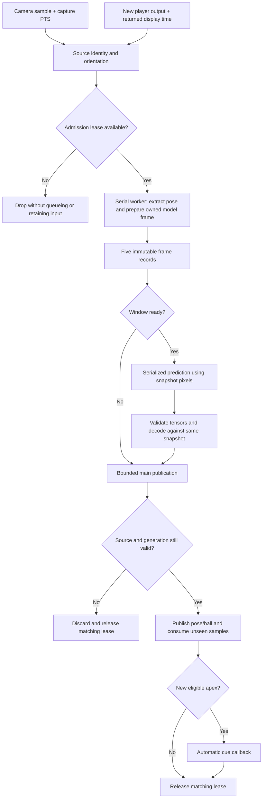

# Phase 1: Consistent Toss Cues — Research

**Researched:** 2026-09-25
**Domain:** Native iPhone temporal inference, bounded scheduling, and toss-cue association
**Confidence:** MEDIUM overall — source inspection and primary Apple documentation; no build, test, clip, or device result is claimed.

## User Constraints

There is no discussion decision to infer: the user requested direct planning from the approved project, requirements, and roadmap. No CONTEXT.md is created. Technical choices below are **planner recommendations**, not newly approved user preferences. [VERIFIED: orchestrator task and user instruction]

- Preserve the native SwiftUI iPhone application, current deployment target, on-device analysis, portrait/right-handed solo setup, bundled model, and both live and saved-video modes. Preserve BallDetectionManager as the integration seam. [VERIFIED: .planning/PROJECT.md, Constraints]
- Preserve portrait-fit/nonportrait-fill model preprocessing, temporal order, independent tensor strides, and FP16 interpretation. The approved requirements explicitly resolve the older blanket aspect-fill note in favor of current preprocessing. [VERIFIED: .planning/REQUIREMENTS.md, Acceptance Notes; .planning/ROADMAP.md, Phase 1 and Phase 3 planning notes]
- Preserve the existing four-second cooldown initially; deduplication is a separate rule. Do not invent numeric FPS, gap, accuracy, latency, or pose-age promises. [VERIFIED: .planning/REQUIREMENTS.md, Acceptance Notes]
- Deliver CUE-01 through CUE-04 through both actual media paths and the automatic-cue callback. Establish identity/reset seams here; complete control-transition acceptance belongs to Phase 2, displayed overlay alignment to Phase 3, and final empirical release verification to Phase 4. [VERIFIED: .planning/ROADMAP.md, Phase 1–4]
- Begin the evaluation protocol and baseline inventory now. Clips, devices, and physical-audio measurement remain unestablished; preserve a reproducible pre-change reference when measurements cannot yet run. [VERIFIED: .planning/ROADMAP.md, Phase 1 planning notes; .planning/STATE.md, Blockers/Concerns]

<phase_requirements>
## Phase Requirements

Descriptions copied from the approved requirements. [VERIFIED: .planning/REQUIREMENTS.md, Current-Toss Feedback]

| ID | Description | Research Support |
|---|---|---|
| CUE-01 | A player's ball result and apex cue use the same source frames, timestamps, and geometry that produced the prediction. | Owned frame records; immutable five-record prediction window; source-time ingress; decoder receives the original window |
| CUE-02 | A player can use analysis without an accumulating backlog of old feedback; processing has a tested finite work/buffer bound. | Admission before dispatch; zero pending-input recommendation; bounded publication, history, and diagnostics; deterministic held-worker tests |
| CUE-03 | A player receives at most one automatic cue for an eligible toss, even when source frames repeat or inference windows overlap. | Generation/source identity; monotonic consumed watermark independent of history; candidate identity; cooldown tested separately |
| CUE-04 | A player's toss height gate uses pose associated with that toss sample, or the documented fallback when valid pose is unavailable. | Same-frame pose value or explicit missing result retained through the window and peak candidate |
</phase_requirements>

## Project Constraints (from AGENTS.md)

Apply these directives during planning and execution. [VERIFIED: AGENTS.md:3-64; user-provided memory instructions]

- Read the complete learnings file before work and append only new, specific observations after work. The parent owns that update for this research task.
- Follow the documentation map, architecture, product/model references, and any active root implementation brief. Prefer durable long-form knowledge under the documentation directory; remove completed temporary briefs.
- Use Swift, two-space indentation, Swift API naming, view/service suffix conventions, private surfaces, final nonsubclassed classes, and one primary type per matching file. Existing four-space code is not permission for unrelated formatting churn.
- Add behavior-focused detection/processing tests in the existing unit target; use XCTest UI tests and test names following the prescribed behavior/condition convention. Run relevant tests before shipping.
- Keep target/folder names and bundle identity. Do not manually edit project membership for ordinary new app files: synchronized groups manage membership. Keep archived code unwired.
- Keep capture lifecycle separate from analysis, per the learnings entry about stop responsiveness. Keep domain logic in detectors, runtime work in managers, composition in views.
- Keep camera/microphone usage descriptions present. Do not commit personal identifiers, signing material, or build output. Use error logs only in production; any diagnostic capture should be explicit, bounded, local, and disabled normally.
- Use imperative commit subjects no longer than 72 characters and explain why; PRs describe approach and validation, link issues, and include UI evidence when relevant. The parent handles commits.
- Preserve model channel/head order, temporal order, tensor-specific strides, coordinate origin, and generated-model workflow. Do not retrain/reconvert or edit generated Swift for this phase.

**Explicit precedence resolution:** The historical instruction says `Pre-resize with aspect‑fill (no letterboxing).` and `Default target frame is t=2 (middle) for accuracy.` The approved milestone preserves current portrait-fit behavior and current freshest overlays; do not turn this phase into a preprocessing or overlay-index change. [VERIFIED: AGENTS.md:58-60; .planning/PROJECT.md, Context; .planning/REQUIREMENTS.md, Acceptance Notes]

## Summary

The current manager submits an asynchronous closure for each processed frame, then checks and clears its busy flag inside that serial closure. Therefore the check serializes execution but does not reject pending submissions. Prediction uses mutable frame storage, while timestamps and mappings are read later in separate synchronized operations. These source-level failure mechanisms justify a unified frame/window contract and admission before dispatch. They are not measured failure frequencies. [VERIFIED: Tennis Trainer/BallDetectionManager.swift:63-90; Tennis Trainer/Detectors/GridTrackNetDetector.swift:175-203,319-320,389-414]

Pose is presently published asynchronously into shared state and remains unchanged when Vision finds no observation. Apex evaluation subsequently reads that latest shared pose while considering historical ball candidates. Camera timing is sampled after pose work; playback supplies requested player time rather than the returned output display time. These are association problems independent of the model's detection quality. [VERIFIED: Tennis Trainer/PoseDetectionManager.swift:17-31,109-118; Tennis Trainer/Detectors/ServeTossApexDetector.swift:71-85; Tennis Trainer/CameraManager.swift:177-194; Tennis Trainer/VideoPlayerManager.swift:87-110]

**Primary recommendation:** Use one bounded end-to-end analysis job, immutable frame/window records, sample-associated pose, and a single publication boundary in BallDetectionManager. Keep the current native stack and model. Measure the resulting admitted cadence before claiming real-world cue quality. This is an engineering recommendation derived from the source findings above and Apple's streaming-work guidance. [CITED: https://developer.apple.com/videos/play/wwdc2023/10049/]

## Architectural Responsibility Map

Recommended responsibility allocation; all tiers are on-device. No server, database, or external AI service is introduced. [VERIFIED: .planning/PROJECT.md, Constraints and Out of Scope]

| Capability | Primary Tier | Secondary Tier | Rationale |
|---|---|---|---|
| Capture/player source time and identity | Native media managers | Core Media / AVFoundation | Stamp the frame while its originating source is known |
| Admission and work ownership | BallDetectionManager | Short Foundation synchronization | One place accounts for accepted work through completion |
| Pose extraction | PoseDetectionManager worker boundary | Vision | Produce a value from the exact admitted image |
| Model preparation and prediction | Detector worker | Core Image / Core ML | Own pixels, geometry, temporal ordering, and serialized model access |
| Candidate, dedupe, and cooldown | ServeTossApexDetector | BallDetectionManager | Cue rules remain domain logic |
| Final visible state and automatic callback | Main publication boundary | ContentView / AudioManager | One accepted result produces one coherent effect batch |
| Baseline protocol and evidence | Local test/documentation artifacts | Human clip/device verification | Separate deterministic invariants from measured reliability |

## Standard Stack

Retain the existing native frameworks. System frameworks ship with the SDK/OS; an npm/PyPI package version or publication date is not applicable. No external installation or package-legitimacy audit is required by this recommendation. [VERIFIED: .planning/PROJECT.md, Constraints; source imports in the inspected managers]

| Technology | Version / baseline | Use |
|---|---|---|
| Swift / SwiftUI | Keep language setting `SWIFT_VERSION = 5.0;` and deployment setting `IPHONEOS_DEPLOYMENT_TARGET = 18.5;` | Existing app and test targets [VERIFIED: Tennis Trainer.xcodeproj/project.pbxproj:325,420] |
| AVFoundation / Core Media | System APIs compatible with deployment baseline | Capture PTS, distinct playback output, source-time values [CITED: https://developer.apple.com/documentation/coremedia/cmsamplebuffergetpresentationtimestamp(_:)] |
| Core ML | Existing bundled model, serialized synchronous prediction | No model or inference-framework migration [CITED: https://developer.apple.com/videos/play/wwdc2023/10049/] |
| Vision | Existing body-pose request | Image-associated joints and confidence [CITED: https://developer.apple.com/documentation/vision/detecting-human-body-poses-in-images] |
| Core Image / Core Video | Existing scaler and buffer ownership | Preserve orientation, fit/fill, and source mapping [VERIFIED: Tennis Trainer/PixelBufferScaler.swift:15-119] |
| Foundation / Dispatch | Existing queue/lock idiom | Short admission synchronization, one worker, one main publication; recommendation |
| XCTest | Existing project test target | Dependency-injected deterministic tests [VERIFIED: Tennis TrainerTests/ServeTossApexDetectorTests.swift:1-5] |

**Do not install:** a reactive pipeline package, atomics package, LLM framework, or replacement pose/model framework. Native seams are sufficient for the identified work; this is a scope/architecture recommendation, not a benchmark claim.

## Architecture Patterns

### System Architecture Diagram

Recommended flow:



### Pattern 1: One immutable frame record; one immutable prediction window

Recommended record contents: source identity, analysis generation, monotonically assigned frame identity, original rational media time, separate monotonic ingress time for diagnostics, raw/oriented dimensions, orientation, model mapping, owned model pixels, and that frame's pose value or explicit missing pose. Suggested type names are not existing APIs; let the pattern mapper choose local names.

Preserve source `CMTime` for identity/order and derive seconds only for cue arithmetic. Camera ingress should read the sample buffer presentation timestamp before any pose work. Playback should query new output, copy it once, and retain the returned display time. Reject invalid/nonfinite time; do not manufacture host time when metadata is absent. Apple returns an invalid time on capture timestamp errors, and its player output tracks which images were acquired. [CITED: https://developer.apple.com/documentation/coremedia/cmsamplebuffergetpresentationtimestamp(_:); https://developer.apple.com/documentation/avfoundation/avplayeritemvideooutput/copypixelbuffer(foritemtime:itemtimefordisplay:)]

Snapshot the entire ordered record array before prediction. Pass the snapshot explicitly to decoder/result construction; remove post-prediction reads of mutable timestamps/mappings. The model adapter should accept that window, return raw outputs, and be injectable in tests. Keep actual Core ML prediction serialized per model, with no short admission lock held across inference. [VERIFIED: Tennis Trainer/Detectors/GridTrackNetDetector.swift:175-203,389-414; CITED: https://developer.apple.com/videos/play/wwdc2023/10049/]

Use value ownership, not merely `let`: buffers are reference-backed. Never overwrite a buffer still referenced by a window. Ensure the fast path also produces an app-owned prepared buffer or explicitly accounts for retained capture buffers. Currently the orientation helper returns the input for its identity case (`guard orientation != .up else { return pixelBuffer }`), and the exact-size detector path retains that result (`bufferToAppend = orientedBuffer`). [VERIFIED: Tennis Trainer/PixelBufferScaler.swift:100-105; Tennis Trainer/Detectors/GridTrackNetDetector.swift:104-119] Apple warns that prolonged capture-buffer retention can starve delivery. [CITED: https://developer.apple.com/library/archive/technotes/tn2445/_index.html]

### Pattern 2: Bound the entire path before enqueueing

**Recommended initial policy:** one admitted end-to-end job per BallDetectionManager, no pending input slot. Acquire a short synchronized lease before dispatching, retaining input, Vision, or preprocessing. Reject immediately while busy. Hold the lease until final publication/discard completes; otherwise a stalled main queue can accumulate results despite single-flight inference. Put pose publication, ball publication, track/cue consumption, and processed-frame reporting in that same bounded completion. Avoid a separate per-source-frame asynchronous main callback.

This simpler policy is deliberately chosen over the prior research's optional replaceable pending slots. It is a planning recommendation whose performance must be measured; dropping at admission may change model temporal spacing. If measured cadence is inadequate, a separately bounded preparation lane/latest pending window can be proposed with a new explicit retention proof. Do not add that complexity preemptively or claim it preserves accuracy. [ASSUMED: A1 — sufficiency of the simplest policy for real toss coverage remains empirical]

Recommended proof obligations, to be made actual assertions in tests:

| Resource | Proposed maximum per manager | Required accounting |
|---|---:|---|
| Admitted analysis lease / worker job | 1 | Includes any time waiting for serialized pose access |
| Pending input frames/jobs | 0 | Busy submission returns without capturing input in a closure |
| Prepared ring | 5 records | Oldest removed on append; snapshot shares these immutable buffers |
| App-visible preprocessing buffers | Conservative 8 unique buffers | At most 5 ring buffers + 1 input + 1 oriented intermediate + 1 new model buffer; avoid hidden duplicate snapshots |
| Outstanding result publication | 1 | Carries values, not raw tensors or unnecessary pixel buffers |
| Apex history | Constant-size triplet recommended | Retain only what next local-maximum decision requires, plus scalar watermark/cooldown |
| Diagnostic history | 0 normally; fixed cap when enabled | Aggregate counters and bounded trace storage, never unlimited arrays |

These are **proposed implementation bounds**, not measurements. Count unique retained buffers as well as references. Release input/intermediate buffers after preparation and raw outputs after decode. Framework-internal Vision/Core ML allocations and AVFoundation buffers are outside the app-visible count; measure process memory separately. Two retained media managers multiply per-manager bounds: include that aggregate in tests/documentation rather than assuming one mode's worker instantly disappears. [ASSUMED: A2 — the proposed eight-buffer accounting must be confirmed against final ownership implementation]

Every exit must release exactly its own lease: warmup, missing model, failed orientation/resize, prediction error, malformed tensor, obsolete generation, dropped publication, and deallocation. Reset increments identity but must not free an old worker's slot while it is still running; an old completion must never release a newer lease. Coalesce reset requests or apply reset lazily at the next admitted job; do not queue one reset closure per gesture. Recommendation derived from the current unsynchronized reset/inference interaction. [VERIFIED: Tennis Trainer/BallDetectionManager.swift:72-100]

### Pattern 3: Same-frame pose value, never a live provider read

Refactor pose work into a value-returning extraction boundary: run Vision, extract joints and baseline synchronously on the worker, and return a snapshot. UI publication is separate. Missing observations, extraction errors, and low-confidence nose/neck produce explicit missing baseline for that frame. Retain the full frame identity beside pose; no nearest-pose cache or invented age tolerance is needed.

The present baseline policy is nose first, then neck, with `nose.confidence > 0.3` and `neck.confidence > 0.3`; preserve those values initially. The apex constants are quoted below. [VERIFIED: Tennis Trainer/PoseDetectionManager.swift:109-118]

<!-- DATA_7b06f42a_START -->
```swift
private let cooldownSeconds: CFTimeInterval = 4.0
private let bufferHorizonSeconds: CFTimeInterval = 1.5
private let confidenceThreshold: Float = 0.5
private let poseHeightMargin: CGFloat = 0.05
private let frameRelativeFallback: CGFloat = 0.70
```
<!-- DATA_7b06f42a_END -->
Exact current constants. [VERIFIED: Tennis Trainer/Detectors/ServeTossApexDetector.swift:13-17]

Store the candidate's baseline with the candidate entry; use that baseline plus the preserved margin, otherwise the preserved frame-relative fallback. Later published joints must not change an already-recorded candidate. Serialize the whole Vision perform-and-extract transaction because camera and video share a pose manager and can overlap while old work drains. A worker per ball manager does not serialize their shared request. [VERIFIED: Tennis Trainer/PoseDetectionManager.swift:11-28; Tennis Trainer/ContentView.swift:83-88; .planning/research/ARCHITECTURE.md, Pose pairing]

### Pattern 4: Identity deduplication independent of history and cooldown

The current dedupe only checks against the last retained valid sample; it skips invalid detections before advancing that check. Its history is pruned by time rather than count. [VERIFIED: Tennis Trainer/Detectors/ServeTossApexDetector.swift:35-65]

Recommend a monotonic consumed-frame watermark scoped to source and generation, maintained independently of history eviction. Ignore repeated/equal or older source times and already-consumed identities. Advance the watermark even for a missing/low-confidence detection so repeated windows cannot later rewrite the same frame's cue history. The first consumed estimate for a source frame is authoritative for cue evaluation; subsequent model estimates may be used for display only if explicitly separate. This is a technical dedupe recommendation, not a user-approved estimator preference.

Evaluate each candidate once when its next valid neighbor is available, record candidate identity, and maintain cooldown in the source timeline. Do not implement unbounded sets of all seen frames/events. A fixed-size local-maximum state plus monotonic watermark suffices for ordered input; test this property with overlap, history eviction, and reordered results. Preserve the existing horizon as a temporal constraint when compacting history; characterize batching behavior before changing it. A constant-size streaming triplet is a recommendation requiring regression equivalence checks, not an assertion that all old batch edge cases are identical. [ASSUMED: A3 — compact-history equivalence must be established by tests]

At most one cue per physical toss is evaluated under the current fully-observed eligibility/heuristic definition. Identity dedupe prevents repeated processing of the same candidate; it does not establish a new physical toss segmentation model. Preserve strict local maxima and cooldown; do not expand this phase into noisy-trajectory tuning. [VERIFIED: .planning/REQUIREMENTS.md, Acceptance Notes; Tennis Trainer/Detectors/ServeTossApexDetector.swift:71-103]

### Pattern 5: Source/reset seam now; complete lifecycle later

Introduce a source/generation token and an immediate invalidation entry point, with worker-owned ring clearing and serial cue-state clearing. Check identity inside final publication, not just before dispatch. This gives Phase 2 a usable seam and prevents old worker completion from corrupting a new window. Add focused reset/interleaving tests here. Do not claim every pause/seek/import/permission transition is accepted until Phase 2 wires and verifies that matrix. [VERIFIED: .planning/ROADMAP.md, Phase 1 planning notes]

### Model contract and decoder preservation

Current input/output names are exactly `"f1"`, `"f2"`, `"f3"`, `"f4"`, `"f5"` and `"conf"`, `"x_off"`, `"y_off"`. Preserve them. The model canvas declarations are `let targetW = 768` and `let targetH = 432`; the window tests `frames.count == 5`. [VERIFIED: Tennis Trainer/Detectors/GridTrackNetDetector.swift:106-107,162-172,180-192]

Current temporal sample fields are quoted for the migration seam; extend/replace this contract deliberately rather than inventing existing fields. [VERIFIED: Tennis Trainer/Detectors/GridTrackNetDetector.swift:16-21]

<!-- DATA_283d0ce9_START -->
```swift
struct Sample {
    let tIndex: Int          // 0 (oldest) ... 4 (newest)
    let timestamp: CFTimeInterval
    let position: CGPoint?   // normalized Vision space; nil if below threshold
    let confidence: Float    // best grid confidence at t
}
```
<!-- DATA_283d0ce9_END -->

Unify duplicate decoding paths into a pure testable decoder. Validate each tensor's data type, rank, temporal/spatial dimensions, and indexing before raw access. Preserve FP16 and independent per-output strides. Reject malformed outputs and nonfinite coordinates/confidence rather than attempting heuristic unsafe indexing. Test offset tensors with different strides, swapped spatial storage order, and all temporal indices. Apple defines address offsets from each array's strides and warns that storage need not be contiguous. [CITED: https://developer.apple.com/documentation/coreml/mlmultiarray/3929554-getbyteswithhandler; VERIFIED: Tennis Trainer/Detectors/GridTrackNetDetector.swift:214-283,326-382]

Portrait mapping must retain the existing fit branch (`let isPortraitSource = h > w`, `scale = min(CGFloat(targetW) / CGFloat(w), CGFloat(targetH) / CGFloat(h))`); the other branch uses `scale = max(CGFloat(targetW) / CGFloat(w), CGFloat(targetH) / CGFloat(h))`. Preserve out-of-source rejection and bottom-left conversion. Source-to-display transforms are Phase 3. [VERIFIED: Tennis Trainer/Detectors/GridTrackNetDetector.swift:30-48,121-144]

## Component Responsibilities and Pattern-Mapper Inventory

These are **source locators and proposed edit targets**, not newly created filesystem paths. New helper/test filenames below are recommendations; no application files were changed during research.

| Existing source to map | Responsibility / nearby pattern | Expected phase work |
|---|---|---|
| `Tennis Trainer/BallDetectionManager.swift` | Existing ball/cue seam and main publication | Admission lease, injected dependencies, source/generation, bounded completion |
| `Tennis Trainer/Detectors/GridTrackNetDetector.swift` | Window preparation, model call, decoder | Immutable window, owned buffers, pure decode boundary |
| `Tennis Trainer/Detectors/ServeTossApexDetector.swift` | Local peak, history, cooldown | Associated pose, watermark, bounded history, event identity |
| `Tennis Trainer/PoseDetectionManager.swift` | Vision and baseline extraction | Return per-frame values; serialize extraction; explicit absence |
| `Tennis Trainer/CameraManager.swift` | Existing separate session/video queues | Capture PTS at ingress; cheap submission; bounded processed-frame reporting |
| `Tennis Trainer/VideoPlayerManager.swift` | Player output/display-link callback | New-frame query, returned display time, worker submission |
| `Tennis Trainer/PixelBufferScaler.swift` | Core Image fit/fill/orientation helpers | Preserve transforms; close ownership fast path; test fixtures |
| `Tennis Trainer/ContentView.swift`, `Tennis Trainer/AudioManager.swift` | Automatic callback to beep | Verify wiring with a fake callback; preserve manual Test Beep |
| `Tennis TrainerTests/ServeTossApexDetectorTests.swift` | XCTest fixture/helper pattern | Adapt sample fixture; retain all six existing behavior checks |
| `Tennis Trainer/AppRuntime.swift` | Tests suppress live services | Inject fakes without accidentally initializing Core ML/camera/audio |

Suggested additions: one frame/window value-type file, one pure decoder file if extraction warrants it, admission/association/decoder XCTest files, and one local validation protocol/inventory document under the existing docs knowledge structure. Use a manager suffix only for runtime logic owners; value types remain value types. Recommendations grounded in repository naming rules. [VERIFIED: AGENTS.md:26-37,49-55]

## Don't Hand-Roll

| Problem | Don't Build | Use Instead | Basis |
|---|---|---|---|
| Pose estimator or ball model | New ML framework/model | Existing Vision and bundled Core ML | Approved scope [VERIFIED: .planning/PROJECT.md, Out of Scope] |
| Media timestamp substitution | Guessed FPS or wall-clock media time | Capture PTS / returned player display time | Apple source-time APIs [CITED: https://developer.apple.com/documentation/coremedia/cmsamplebuffergetpresentationtimestamp(_:)] |
| Pixel orientation/scaling | New hand-written image converter | Existing scaler with preservation fixtures | Current behavior [VERIFIED: Tennis Trainer/PixelBufferScaler.swift:15-119] |
| Atomicity via queue assumption | Unlimited async tasks with internal busy checks | Short native lock plus explicit lease ownership | Current queue flaw [VERIFIED: Tennis Trainer/BallDetectionManager.swift:72-76] |
| Test synchronization | Arbitrary sleep-based race tests | Held fake predictor, controlled publication scheduler, expectations | Recommendation |
| Audible latency evidence | Subtract unrelated clocks or callback-only assertion | Later synchronized audiovisual device trial | Approved evidence requirement [VERIFIED: .planning/REQUIREMENTS.md, CHECK-03 and Acceptance Notes] |

## Runtime State Inventory

This is a pipeline refactor, not an identity rename or persistent-data migration. Inventory is limited to inspected code; no claim about absent external installations is made.

| Category | Items Found | Action Required |
|---|---|---|
| Stored data | Frames/times/mappings and cue history are in-memory arrays [VERIFIED: Tennis Trainer/Detectors/GridTrackNetDetector.swift:59-64; Tennis Trainer/Detectors/ServeTossApexDetector.swift:19-27] | Replace/clear runtime representation; no persisted-record migration identified |
| Live service config | Capture/player and ML configuration are local runtime objects [VERIFIED: Tennis Trainer/CameraManager.swift:9-15; Tennis Trainer/VideoPlayerManager.swift:10-15] | Preserve behavior; Phase 2 owns complete lifecycle changes |
| OS-registered state | Camera authorization and AVAudioSession already exist [VERIFIED: Tennis Trainer/CameraManager.swift:29-49; Tennis Trainer/AudioManager.swift:14-18] | No registration rename; do not reset permissions/audio settings for this refactor |
| Secrets/env vars | Test suppression reads `"XCTestConfigurationFilePath"` [VERIFIED: Tennis Trainer/AppRuntime.swift:3-6] | Preserve test behavior; no secret migration identified within edited scope |
| Build artifacts | Xcode compiles the app/model; no model conversion planned [VERIFIED: .planning/PROJECT.md, Out of Scope] | Rebuild normally; do not edit generated model interfaces or commit derived output |

## Common Pitfalls

1. **Fix only the inference queue.** Pose still runs on playback main and per-frame publication can accumulate. Bound ingress through publication and move expensive work behind admission. [VERIFIED: Tennis Trainer/VideoPlayerManager.swift:77-110; Tennis Trainer/BallDetectionManager.swift:63-90]
2. **Snapshot only timestamps.** Pixels, pose, orientation, and mapping can still disagree. Snapshot one record array; test using differently shaped later frames while a predictor is held. [VERIFIED: Tennis Trainer/Detectors/GridTrackNetDetector.swift:175-203,389-414]
3. **Release busy on reset.** A prior job may still run and its completion may release a new job. Match release to lease identity; never block UI waiting for synchronous prediction. Recommendation.
4. **Time-only history is called finite.** Arbitrarily dense timestamps can grow entries inside the horizon. Add a count bound or compact state, and assert it under adversarial input. [VERIFIED: Tennis Trainer/Detectors/ServeTossApexDetector.swift:43-65]
5. **Cooldown hides dedupe regressions.** Check unseen-frame/candidate counts independently, including replayed old windows after history eviction and repeated nil/low-confidence frames. Keep reset as the only route to a new timeline. Recommendation.
6. **Shared pose request used concurrently.** Two manager workers may overlap; serialize Vision extraction or give workers isolated requests. Do not read mutable published joints for a candidate. [VERIFIED: Tennis Trainer/PoseDetectionManager.swift:11-28,109-118]
7. **Immutable record wraps mutable reused pixels.** Retention is not a deep copy; test that later preparation cannot modify an active window. [VERIFIED: Tennis Trainer/PixelBufferScaler.swift:100-119]
8. **Latest SDK warning prompts an OS migration.** Apple now deprecates the old player copy API, but the installed SDK declares `ios(6.0, 27.0)` for it. Retain the baseline-compatible call for this phase; do not adopt a newer replacement without availability checks. [VERIFIED: Apple iPhoneOS SDK AVPlayerItemOutput.h:234-236; CITED: https://developer.apple.com/documentation/avfoundation/avplayeritemvideooutput/copypixelbuffer(foritemtime:itemtimefordisplay:)]
9. **Bounded work is reported as bounded audible latency.** A finite queue does not establish execution duration, sampling sufficiency, or physical sound onset. Record missing evidence explicitly. [VERIFIED: .planning/REQUIREMENTS.md, Acceptance Notes]

## Code Examples

API usage sketches below are proposed integration code, not existing repository definitions or compiled proof. Application-specific submission remains intentionally omitted.

Capture source time before analysis. The timestamp API may return invalid time; fail closed rather than substituting uptime. [CITED: https://developer.apple.com/documentation/coremedia/cmsamplebuffergetpresentationtimestamp(_:)]

```swift
let sourceTime = CMSampleBufferGetPresentationTimeStamp(sampleBuffer)
guard sourceTime.isValid, sourceTime.isNumeric else { return }
// Submit sourceTime with this sample's buffer, source token, and orientation.
```

Acquire playback output once and carry the returned display time. [CITED: https://developer.apple.com/documentation/avfoundation/avplayeritemvideooutput/copypixelbuffer(foritemtime:itemtimefordisplay:)]

```swift
let requestedTime = player.currentTime()
guard output.hasNewPixelBuffer(forItemTime: requestedTime) else { return }
var frameTime = CMTime.invalid
guard let pixels = output.copyPixelBuffer(
  forItemTime: requestedTime,
  itemTimeForDisplay: &frameTime
), frameTime.isValid, frameTime.isNumeric else { return }
// Try immediate admission with pixels and frameTime; never queue busy input.
```

The installed Apple SDK describes the output parameter as `the true display deadline for the copied pixel buffer`; its role is the acquired frame's media timeline association, not host execution time. [VERIFIED: Apple iPhoneOS SDK AVPlayerItemOutput.h:228-231]

## Testing Strategy

The optional Nyquist Validation Architecture section is intentionally omitted: configuration contains `"nyquist_validation": false`. Required phase regression testing remains in scope. [VERIFIED: .planning/config.json:20-24]

Existing tests cover one accepted parabola, two tosses outside/inside cooldown, a below-height peak, pose suppression, and low-confidence peak suppression. They do not yet exercise injected workers or output tensors. [VERIFIED: Tennis TrainerTests/ServeTossApexDetectorTests.swift:43-119]

| Requirement | Essential deterministic tests | Integration evidence |
|---|---|---|
| CUE-01 | Hold fake prediction for window A, submit B with different time/geometry, release A; assert all five identities, pixels/sentinels, mappings, and pose stay A. Malformed metadata must fail closed. Tensor fixtures cover FP16, all indices, independent strides, invalid types/shapes/NaNs, fit/fill mapping. | Both camera and player adapters pass actual source time and orientation into the common seam |
| CUE-02 | Hold worker; submit a large burst; assert admitted=1, pending=0 and input-release counts. Hold publication; repeat burst. Exercise every error/reset exit. Assert ring/history/trace counts and aggregate two-manager bound. | No Vision/Core Image/model call on display-link main callback; no unbounded per-frame UI callbacks |
| CUE-03 | Identical window twice; sliding overlap; equal timestamps; out-of-order/evicted old frames; missing then later-confident same frame; two eligible separated tosses; independent cooldown checks; reset/source change. Assert callback counts and consumed candidate identities. | Fake automatic-cue callback through both managers; manual beep excluded |
| CUE-04 | Candidate's nose permits while later nose rejects, and reverse; neck fallback; missing pose after valid pose; error/low confidence; delayed observation/source mismatch. | Actual pose extraction returns a value tagged to the admitted frame; UI publication cannot substitute pose |

Use deterministic gates/schedulers, not timing luck or real model inference for concurrency tests. Inject the model adapter and pose producer before constructing production services so tests do not load the model as a side effect. Keep a small separate bundled-model smoke check for integration, and record where it cannot run. Recommendations.

The parent preflight reports Xcode 27.0 build 27A266a and an available iPhone 17 Pro simulator on iOS 26.5. The repository's iPhone 15 example destination is unavailable on this host. These are orchestrator-reported tool observations, not research execution results. [VERIFIED: parent read-only environment preflight, 2026-09-25]

Proposed execution command (not run during planning):

```sh
xcodebuild test -scheme 'Tennis Trainer' \
  -destination 'platform=iOS Simulator,name=iPhone 17 Pro,OS=26.5' \
  -only-testing:Tennis\ TrainerTests
```

Use class-specific `-only-testing` selectors during implementation and the full unit target after integration. Do not promise a sub-30-second wall time: simulator startup/build cost is unmeasured. Keep deployment at the existing baseline even when using a newer simulator. Recommendations.

## Baseline Protocol and Evidence Started in Phase 1

**Reproducible source reference:** `1bae995d96650b2619faeebe568a36715f50db0d` (`docs: create roadmap (4 phases)`) was HEAD with a clean worktree at research ingress. This is a source reference, not a scored baseline. [VERIFIED: git rev-parse HEAD, git log -1, git status --short, 2026-09-25]

Create one protocol plus inventory before tuning. Recommended fields:

- Clip identifier/hash, permission/provenance, local ownership, source dimensions/orientation/frame rate/timebase, and availability status. Do not download arbitrary footage or assert permitted reuse without evidence.
- Label each apex as an interval, fully observed/partial/ambiguous, with confidence/height/cooldown eligibility and labels made independently of detector outputs.
- Record build/source reference, model checksum, detector settings, preprocessing policy, admission policy, accepted times/gaps, drop counts, and source/generation/window/candidate identity.
- Define one-to-one cue-to-labeled-apex matching, duplicate/extra/missed/stale classification, excluded/ambiguous denominators, playback speed, and trial repetitions before final scoring. Numeric timing/matching limits remain pending baseline evidence.
- Separate source apex time, confirmation time, worker completion, callback scheduling, and physical beep onset. Host performance timestamps and media timestamps need explicit mapping; subtracting them directly is invalid.
- Inventory physical iPhone, OS/build, camera setup, audio route, measurement method, synchronization uncertainty, and sustained-run conditions. Distinguish absent evidence from failures and passes.
- Preserve tuning versus confirmation cases when enough clips exist. Freeze final criteria before the Phase 4 confirmation run, with changes versioned and explained.

These recommendations implement the approved early-baseline requirement. No corpus, device, or numeric acceptance bound is asserted. [VERIFIED: .planning/REQUIREMENTS.md, CHECK-02/CHECK-03 and Acceptance Notes]

## Security Domain

Configuration explicitly contains `"security_enforcement": true` and `"security_asvs_level": 1`. This local native pipeline needs input validation, resource bounds, safe concurrency, and local-data minimization; it does not introduce authentication or a network API. [VERIFIED: .planning/config.json:48-50; .planning/PROJECT.md, Out of Scope]

The template's old V2/V3/V4 labels belong to an earlier ASVS numbering. Use the current ASVS 5 category names below as a planning taxonomy, not a claim of formal web-app compliance. [CITED: https://cheatsheetseries.owasp.org/IndexASVS.html]

| ASVS 5 category | Applicability to Phase 1 | Recommended control |
|---|---|---|
| V2 Validation and Business Logic | Yes | Finite numeric time/geometry/confidence, tensor validation, separate identity and cooldown rules |
| V15 Secure Coding and Architecture | Yes | Bounded resources, owned buffers, synchronized request/lease state, safe concurrency |
| V14 Data Protection | Yes | No uploads; local explicit fixtures; avoid pixel/joint payloads in ordinary logs |
| V16 Security Logging and Error Handling | Limited | Fail closed on malformed outputs; bounded opt-in diagnostics and error logging |
| V6 Authentication / V7 Session Management / V8 Authorization | No new authentication boundary | Analysis generations are runtime identities, not login sessions |
| V11 Cryptography / V12 Secure Communication | No new cryptographic/network function | Do not add custom cryptography or remote services |

| Threat / failure pattern | STRIDE | Mitigation to verify |
|---|---|---|
| Bursts or tiny positive timestamp deltas retain unlimited frames/history | Denial of service | Admission before dispatch; count bounds beyond time horizons |
| Cross-source or stale metadata drives a cue | Tampering / integrity | Immutable association, matching generation, candidate watermark |
| Malformed tensor pointer interpretation | Tampering / denial of service | Validate type/dimensions/strides before indexing; fail closed |
| Local diagnostics leak user media/body data | Information disclosure | Bounded metadata-only diagnostics; no uploads or production noisy logs |

Threat mappings are engineering analysis, not claims of observed attacks.

## State of the Art

| Existing approach | Recommended phase approach | Evidence |
|---|---|---|
| Serial queue with busy check inside queued closure | Gate before enqueue; explicit complete-path lease | Source flaw [VERIFIED: Tennis Trainer/BallDetectionManager.swift:72-76] |
| Mutable parallel pixels/times/mappings | Immutable frame records and prediction window | Source mismatch [VERIFIED: Tennis Trainer/Detectors/GridTrackNetDetector.swift:59-63,389-414] |
| Current UI pose provider | Same-frame pose value / explicit absence | Source mismatch [VERIFIED: Tennis Trainer/Detectors/ServeTossApexDetector.swift:81-85] |
| Assumed display cadence and requested time | Distinct acquired output and returned media time | Apple output contract [CITED: https://developer.apple.com/documentation/avfoundation/avplayeritemvideooutput/copypixelbuffer(foritemtime:itemtimefordisplay:)] |

Async Core ML APIs exist, but adoption is unnecessary for this correctness phase; switching APIs does not supply an app-specific buffer bound. Apple separately discusses limiting concurrent work and dropping stale streaming work. [CITED: https://developer.apple.com/videos/play/wwdc2023/10049/]

## Environment Availability

| Dependency | Availability | Fallback / action |
|---|---|---|
| Xcode and simulator | Parent preflight: Xcode 27.0 / 27A266a; iPhone 17 Pro iOS 26.5 available | Use discovered destination; CoreSimulator access may require sandbox escalation [VERIFIED: parent environment preflight] |
| Native frameworks / bundled model | Existing source imports/model integration inspected | No package install; validate SDK availability and model smoke test during execution [VERIFIED: Tennis Trainer/Detectors/GridTrackNetDetector.swift:1-7,69-78] |
| Context7 MCP / CLI | No matching MCP tools exposed; CLI discovery found no executable in this shell | Official Apple web/SDK sources used; no unverified tool installed [VERIFIED: tool inventory and command -v ctx7 probe] |
| Representative clips / physical device / audio timing rig | Not established | Preserve baseline reference and explicit pending inventory; deterministic work can proceed [VERIFIED: .planning/STATE.md, Blockers/Concerns] |

No missing dependency blocks planning the deterministic fixes. Missing clip/device/audio evidence blocks a later empirical reliability claim, not creation of this phase's plans.

## Assumptions Log

| ID | Claim | Risk if wrong | Handling |
|---|---|---|---|
| A1 | Single end-to-end drop-while-busy policy samples enough of real tosses | Missed apex despite correct bounds | Treat as initial technical recommendation; measure admitted gaps and clip outcomes before locking performance claims |
| A2 | Proposed eight app-visible pixel-buffer maximum covers final implementation | Hidden retained references violate CUE-02 | Executor must provide actual ownership accounting and adversarial assertions; adjust implementation/bound explicitly |
| A3 | Compact triplet history can preserve intended accepted-toss behavior | Changed batch/horizon semantics | Characterize current cases and test horizon, partial, confidence-gap, and overlap behavior before replacement |

These are not approved product preferences or established empirical facts. Do not lock them as measured guarantees. Other architecture prescriptions are recommendations grounded in source/API contracts, not assertions that an implementation already exists.

## Open Questions

The five items below have **resolved planning dispositions** as of 2026-09-25. This resolves where each question is handled; it does not claim the measurements or implementation checks have already passed.

1. **Sampling sufficiency:** What admitted-frame gaps occur on supported hardware under the recommended bound, and which fully observed tosses remain detectable? Start measurement with baseline clips; do not invent a gap threshold.
   **RESOLVED (planning disposition):** 01-01 Task 1 preserves the baseline and measurement protocol before implementation. 01-03 Task 2 records admitted gaps, drops, resource bounds, and any available clip evidence. Sampling sufficiency remains empirically unverified; Phase 4 owns final clip/device acceptance against frozen criteria.
2. **Empirical inputs:** Which permitted clips, physical iPhone, and audio synchronization setup are available? Record unavailable items now; final evidence remains a later gate.
   **RESOLVED (planning disposition):** 01-01 Task 1 creates the availability/provenance inventory; 01-03 Task 2 carries outstanding evidence into the handoff. Unknown resources stay explicitly unavailable or pending. Phase 4 cannot claim verified reliability without its required clip/device/audio evidence.
3. **Tensor reality:** Fixture-test the preserved layout and run one bundled-model contract smoke check during implementation. Static decoder assumptions are not a substitute for inspecting actual model outputs.
   **RESOLVED (planning disposition):** 01-03 Task 1 owns strict tensor fixtures and the separate bundled-model smoke check. Record actual output names, shapes, types, and strides when run; a skipped or unavailable smoke remains incomplete evidence, never a pass. No model execution has occurred during planning.
4. **First-observation cue estimates:** Deduping each frame once makes history deterministic but fixes the first decoded estimate despite later contextual estimates. Record this estimator policy and compare clip outcomes before proposing any different policy.
   **RESOLVED (planning disposition):** 01-02 Task 3 selects and tests the first-observation identity policy, including repeated windows, missing estimates, and replay after history pruning. 01-03 Task 2 documents that policy in the evidence ledger. Any later estimator change requires recorded evidence; the policy is a technical planning choice, not a newly approved user preference.
5. **Baseline comparison:** The old app does not preserve exact source timing throughout the pipeline. Baseline capture must state that limitation; do not compare its callback timestamps as though they were physical/audio ground truth.
   **RESOLVED (planning disposition):** 01-01 Task 1 records the pre-change source reference and timing limitations before edits. 01-03 Task 2 separates source time, software scheduling, and physical sound onset in the ledger. The future Phase 4 comparison must retain those distinctions; no baseline accuracy or audio timing is claimed here.

No unresolved question prevents implementation planning; none authorizes fabricated verification results.

## Sources and Research Method

**Local primary evidence:** Full required project/learnings reading and focused line-numbered source reads of the files in the pattern inventory. Local source tags describe inspected implementation, not runtime proof. Filesystem paths in the inventory are locators, not new artifact-creation claims.

**Official platform sources (MEDIUM retrieval confidence):**

- [Apple TN2445](https://developer.apple.com/library/archive/technotes/tn2445/_index.html), revised 2017-07-12: capture retention, drops, and frame-delivery bounds.
- [Core ML integration, WWDC23 session 10049](https://developer.apple.com/videos/play/wwdc2023/10049/): serialized synchronous predictions and streaming-work policies.
- [Player pixel-buffer copy](https://developer.apple.com/documentation/avfoundation/avplayeritemvideooutput/copypixelbuffer(foritemtime:itemtimefordisplay:)): acquired frames and returned time; cross-checked with installed Apple SDK header.
- [Capture presentation timestamp](https://developer.apple.com/documentation/coremedia/cmsamplebuffergetpresentationtimestamp(_:)): source time and invalid return.
- [Core ML array byte access](https://developer.apple.com/documentation/coreml/mlmultiarray/3929554-getbyteswithhandler): dtype and stride interpretation; cross-checked with installed Apple SDK header.
- [Vision body-pose detection](https://developer.apple.com/documentation/vision/detecting-human-body-poses-in-images): image requests, joints, confidence.
- [OWASP ASVS 5 index](https://cheatsheetseries.owasp.org/IndexASVS.html): current category taxonomy.

The research-plan seam selected Context7 for three question groups. MCP/CLI were unavailable, so official web and installed Apple SDK sources were used. `classify-confidence --provider websearch --verified` returned `MEDIUM`. Generic `codebase` is not recognized as a high-confidence provider by that seam (it returned `LOW`); local source citations remain direct observations, and overall design confidence is conservatively MEDIUM. Apple living API pages did not expose publication dates; no inferred date is claimed.

Global curated-cache writes failed with sandbox EPERM. Digests were successfully stored using the web-source project cache under the temporary working directory; canonical findings are all retained here. No package was installed, build/test run, app code changed, or commit created by this researcher.

## Metadata

| Area | Confidence | Reason |
|---|---|---|
| Standard stack | MEDIUM | Approved native baseline, inspected integration, official API contracts |
| Architecture | MEDIUM | Source-grounded proposed ownership/admission changes; implementation tests pending |
| Pitfalls | MEDIUM | Concrete code paths support mechanisms; frequency/device impact unmeasured |
| Cue accuracy and audible latency | LOW / unestablished | No empirical trial conducted |

**Valid until:** Recheck source citations after implementation edits; recheck platform references in 30 days or on an SDK/API change. Numeric empirical acceptance remains unset until evidence is acquired and criteria frozen.
