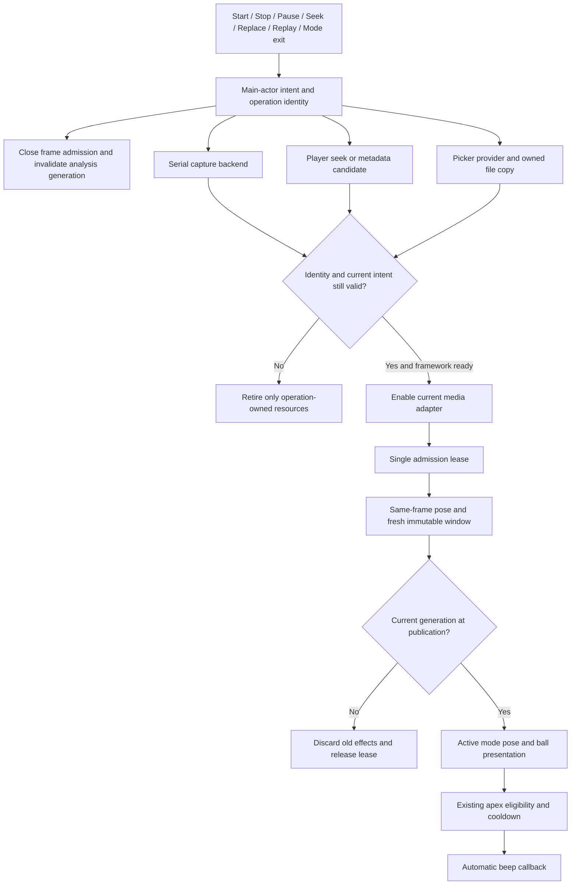

# Phase 2: Dependable Practice Controls — Research

**Researched:** 2026-09-26
**Domain:** Native iOS capture, playback, asynchronous lifecycle and local media ownership
**Confidence:** MEDIUM overall; platform documentation confidence returned by the GSD classifier, with direct source inspection grounding current implementation findings.

## User Constraints

No discussion context was supplied. The orchestration instruction explicitly authorizes planning from approved requirements and research without a discussion round. The architecture and implementation choices below are **research recommendations, not additional locked user decisions**. [VERIFIED: research assignment]

Preserve the existing Apple-framework app, portrait/right-handed solo practice, on-device processing, deployment target, target/folder/bundle identity, existing cue and manual Test Beep. Preserve Phase 1 immutable evidence, admission lease through publication, independent cooldown, and exact candidate pose or strict missing-pose fallback. Do not redesign the UI, replace the model, change preprocessing/geometry, add cloud services, or introduce cues. Geometry belongs to Phase 3; empirical clip/device/audio acceptance remains Phase 4. [VERIFIED: .planning/PROJECT.md:89-98; .planning/REQUIREMENTS.md:47-59,69-79; .planning/phases/01-consistent-toss-cues/01-VERIFICATION.md:56-76]

The current deployment declaration is `IPHONEOS_DEPLOYMENT_TARGET = 18.5;`; retain it. [VERIFIED: Tennis Trainer.xcodeproj/project.pbxproj:325-325]

## Summary

Build on the Phase 1 scheduler; do not replace it. It already assigns source/generation/frame identities before dispatch, owns one lease until the last publication effect, invalidates generations synchronously, and checks validity after observable effects. The missing work is complete lifecycle integration in the media adapters and presentation. Stop and Pause currently stop ingress without resetting analysis. Seeking resets tracking but neither pauses processing nor waits for completion. Metadata and picker callbacks lack current-request checks. [VERIFIED: Tennis Trainer/BallDetectionManager.swift:179-284; Tennis Trainer/CameraManager.swift:128-153; Tennis Trainer/VideoPlayerManager.swift:43-85,173-199; Tennis Trainer/VideoPickerView.swift:31-65]

Two subtle boundaries deserve explicit tasks. First, the camera checks its enabled flag separately from submitting the sample, so invalidation between those operations can allow an old callback to acquire a new analysis generation. Second, both media managers publish through the same pose presenter; an old manager's clearing publication can clear the other mode's current pose. These are source-derived race hypotheses requiring adversarial tests, not claims of reproduced device failures. [VERIFIED: Tennis Trainer/CameraManager.swift:164-189; Tennis Trainer/ContentView.swift:17-20,53-57; Tennis Trainer/BallDetectionManager.swift:237-258,276-281; Tennis Trainer/PoseDetectionManager.swift:72-81]

**Primary recommendation:** Use explicit user intent plus operation identity at every asynchronous boundary; make invalidation synchronous, make framework teardown asynchronous where required, and prove the complete control-to-cue path with held callbacks before expanding the UI states. [Recommendation derived from the inspected sources above and Apple lifecycle documentation below.]

## Architectural Responsibility Map

The following is the recommended ownership map; all capabilities stay on the device. Existing manager/view boundaries are defined by the project. [VERIFIED: .planning/PROJECT.md:93-97]

| Capability | Primary tier | Secondary tier | Recommended responsibility |
|---|---|---|---|
| Stop/Pause/mode intent | Native UI/main actor | Media manager | Update desired operation, close analysis admission, invalidate pending effects synchronously |
| Capture permission | Camera manager | SwiftUI/UIKit presentation | Query/request authorization; expose denial/restriction; view opens Settings and forwards scene return |
| Capture configuration/start/recovery | Capture session queue | Main actor state | Own AV operations, report actual outcomes, honor latest intent |
| Seek/end/replay | Playback manager/main actor | AVPlayer | Own desired playback and latest item/seek identity; gate extraction until successful current seek |
| Picker import and owned copy | Import manager/provider callback | Foundation filesystem | Copy while provider URL is valid; hand off explicit ownership only to the current candidate |
| Pose/ball/cue computation | Existing analysis worker | Publication queue/main actor | Keep Phase 1 bounded work, immutable windows, generation checks |
| Visible overlays and beep | Active mode presentation | Existing audio manager | Read only active mode's state; schedule automatic sound only through current valid publication |

## Project Constraints (from AGENTS.md)

These are actionable repository rules, not optional research preferences. [VERIFIED: AGENTS.md:3-64; user-supplied memory instructions]

- Read the root learnings before work; apply successful patterns and avoid recorded failures. Record only new project-specific observations afterward, using date, observation, action and confidence. The parent coordinates this update for the research/planning task.
- Follow the docs map, architecture and product references; inspect any root execution brief before modifying its area; remove a temporary brief when its scope is complete. Prefer long-lived knowledge in the docs knowledge base.
- Use Swift with two-space indentation, readable lines, Swift API naming, views as structs, final classes where appropriate, minimal private/fileprivate interfaces, one primary type per matching filename. Logic types end in Manager; UI types end in View; integrate through ContentView.
- Add/adjust meaningful detection/processing tests. Use XCTest for UI tests and the existing unit target; name tests by observable behavior. Run relevant tests and the full regression before completion. Avoid unrelated formatting churn.
- Preserve target/folder and bundle identifier. New app files are included by the synchronized Xcode group; do not add unnecessary project-file edits. Archived code stays unwired; document revival if archiving code.
- Preserve camera/microphone usage descriptions and update their messages only if behavior changes. Never commit signing material, personal identifiers or build artifacts. Use error logs only in production, without noisy frame logging.
- Preserve temporal order, tensor-specific strides, axis meanings, FP16 decoding and model conversion workflow. Do not edit generated model Swift.
- Use imperative commit subjects of at most 72 characters and a short why-focused body. PRs describe approach, tests/manual QA, relevant issues and screenshots/recordings for UI changes. Parent owns this task's commit.

The older blanket aspect-fill/middle-output guidance must not trigger a preprocessing edit here: current approved constraints explicitly preserve portrait-fit/nonportrait-fill and Phase 1 behavior. The source adapters use `overlayTIndex: 4`. [VERIFIED: AGENTS.md:58-63; .planning/REQUIREMENTS.md:54-54; Tennis Trainer/CameraManager.swift:201-202; Tennis Trainer/VideoPlayerManager.swift:225-226]

<phase_requirements>
## Phase Requirements

Descriptions below are verbatim approved requirements; research support is prescriptive implementation guidance. [VERIFIED: .planning/REQUIREMENTS.md:21-22,31-39]

<!-- DATA_8f2c1b7a_START -->
| ID | Description | Research support |
|---|---|---|
| LIFE-01 | After Stop, Pause, seek, clip replacement, completion, or mode exit, no invalidated work can publish an overlay or schedule a new automatic beep. | Immediate adapter admission closure plus scheduler reset; protect frame acquisition race and cross-mode pose clearing; test held worker and held publication for every transition |
| LIFE-02 | Starting or resuming analysis after a reset builds a fresh temporal window and cannot issue a retrospective cue from the previous session or timeline. | Retain worker-owned reset and lease; require fresh five-frame warmup and new cue domain before resuming; replay resets cooldown |
| CAM-01 | A player can request camera access when undetermined, reach Settings when denied, understand restricted access, and have access rechecked on return. | Inject authorization provider, wire permission action, use Settings URL and scene-active recheck, separate access from capture intent |
| CAM-02 | A player sees the actual capture state and can stop safely during startup, interruption, or recovery without a later completion restarting analysis against their intent. | Serialized session backend, actual-state observation, explicit desired capture, generation-checked outcomes; Stop available throughout startup/recovery |
| PLAY-01 | A player can seek repeatedly, and only the latest successfully completed seek can resume analysis if playback is still requested. | Item/load identity plus seek identity and requested-play predicate; pause extraction before seek and reject false/superseded completion |
| PLAY-02 | A player sees an ended state when a clip finishes and can replay from the beginning with fresh tracking and cooldown state. | Item-filtered end event, immediate invalidation, explicit ended presentation, replay through current completion-gated seek-to-zero |
| PLAY-03 | A player can replace a clip or recover from a failed/cancelled import without an old load or callback taking over the current selection. | Candidate-vs-committed selection; owned metadata task and import progress; current-request checks after every suspension; preserve last usable paused item on failed/cancelled candidate |
| PLAY-04 | A player can repeatedly play and replace clips without accumulating duplicate processing loops or orphaned app-owned video copies; externally owned files are preserved. | Idempotent display-link management, resource owner pairs, unique copies, explicit teardown, ownership-aware deletion and stale-result cleanup |
<!-- DATA_8f2c1b7a_END -->
</phase_requirements>

## Standard Stack

Retain the native stack; this phase needs no external packages or registry installation. This is a recommendation constrained by the approved no-framework-migration scope. [VERIFIED: .planning/REQUIREMENTS.md:79-79]

| Component | Version/baseline | Purpose and source |
|---|---|---|
| Swift/SwiftUI | Project declares `SWIFT_VERSION = 5.0;`; installed compiler reports Swift 6.4 | Keep current language mode, ObservableObject presentation and native controls. [VERIFIED: Tennis Trainer.xcodeproj/project.pbxproj:420-421; `swift --version`, 2026-09-26] |
| AVFoundation | Apple SDK, retain iOS 18.5 target | Capture session, AVPlayer, AVPlayerItem, video output and asynchronous asset loading already used. [VERIFIED: Tennis Trainer/CameraManager.swift:1-13; Tennis Trainer/VideoPlayerManager.swift:1-35,51-68] |
| PhotosUI/Foundation | OS frameworks | Keep picker and file representation; add operation identity and owned-copy management around them. [VERIFIED: Tennis Trainer/VideoPickerView.swift:1-15,39-65] |
| QuartzCore | OS framework | Keep one display link for frame extraction; explicitly invalidate when suspended or retired. [CITED: https://developer.apple.com/documentation/quartzcore/cadisplaylink/invalidate()] |
| XCTest | Bundled with installed Xcode 27.0 | Extend injected manager tests and adapter tracers. Unit scheme includes `BlueprintName = "Tennis TrainerTests"`. [VERIFIED: Tennis TrainerTests/BallDetectionManagerTests.swift:323-426; Tennis Trainer.xcodeproj/xcshareddata/xcschemes/Tennis Trainer.xcscheme:32-44; `xcodebuild -version`, 2026-09-26] |

No package versions/publish dates or package-legitimacy audit apply to this no-install recommendation. Apple documentation is living documentation; fetched pages expose crawl dates, not authoritative release dates for these APIs. Do not derive iOS availability from a crawl date. [VERIFIED: research fetch results, 2026-09-26]

**Alternatives considered:** Replacing the picker/player framework or moving all capture work to the main actor would enlarge this phase without resolving current identity/ownership bugs. Keep existing native adapters and inject their effect boundaries; use a main-actor state model with a dedicated session queue rather than a wholesale concurrency migration. [Recommendation; rationale: inspected architecture plus blocking start behavior cited below.]

## Architecture Patterns

### System architecture diagram

Recommended control and effect flow:



### Component responsibilities and source anchors

These are source locations inspected this session, not a proposed directory migration. New helper/test names must be selected by the planner; no new path below is claimed to exist.

| Existing component | Current behavior / planning action |
|---|---|
| CameraManager | Separate lifecycle and frame queues already exist. Keep them. Replace permission Boolean-only interpretation and optimistic running state with explicit access/operation state; inject permission/session effects. [VERIFIED: Tennis Trainer/CameraManager.swift:5-15,30-94,128-153] |
| VideoPlayerManager | Owns player, item, layer, output, observer and display link; add current-operation state and transactional loading here. Preserve `FrameOutputReading` and copied display time. [VERIFIED: Tennis Trainer/VideoPlayerManager.swift:4-35,43-85,109-127,234-268] |
| VideoPickerView | Coordinator currently publishes a raw URL after a filename-based copy. Move copy ownership/request validity into a durable import manager or injected service, with the view reporting picker outcomes. [VERIFIED: Tennis Trainer/VideoPickerView.swift:24-65] |
| ContentView | Wires both automatic cues straight to audio, shares pose, and conditionally stops camera only when recording appears true. Wire mode exit unconditionally and render controls/status from explicit state. [VERIFIED: Tennis Trainer/ContentView.swift:53-98,147-188,368-386] |
| BallDetectionManager | Preserve one lease, post-effect validity checks and deferred worker reset. Extend admission only if needed to atomically enforce lifecycle intent; avoid rebuilding its scheduler. [VERIFIED: Tennis Trainer/BallDetectionManager.swift:179-284] |
| PoseDetectionManager | Its publish method accepts any pose and replaces current display values. Prefer one mode-owned presenter per adapter so retired mode clearing cannot alter active display. [VERIFIED: Tennis Trainer/PoseDetectionManager.swift:72-81; Tennis Trainer/ContentView.swift:53-57] |

### Pattern 1: Synchronous intent, asynchronous effects

**Recommendation:** Treat a user transition as committed before dispatching framework work: close ingress, invalidate the current generation, update requested state, then queue stop/seek/teardown. Never clear the existing lease early to make restart appear responsive. New offers can be dropped until the previous publication releases capacity; reset coalescing already prevents a backlog. [VERIFIED: Tennis Trainer/BallDetectionManager.swift:261-284,89-97; Tennis TrainerTests/BallDetectionManagerTests.swift:401-425]

Keep identity domains separate: media selection/load identity, capture operation identity, seek request identity, and the existing analysis generation. A seek within the same item needs a new request and analysis generation, but not a fictitious new file. A new clip needs a new source domain. Check captured identities after the callback is marshaled onto its state-owning executor; checking before a queue hop leaves another race. [Recommendation grounded in current source/generation comparison, Tennis Trainer/BallDetectionManager.swift:72-74,179-198,261-267.]

**Ingress proof obligation:** close the camera's check-to-admission gap. Use a short synchronized adapter transaction or an expected ingress epoch checked atomically with analysis admission. Do not hold a lock through Vision, model prediction or AV session start/stop. Account for callbacks already queued on the capture-output queue when reopening: establish a queue-drain or equivalent verified boundary before admitting the new run, rather than retagging an old acquired buffer with the new generation. Add a deterministic test that suspends a callback between acquiring permission to submit and admission, then Stop/Start occurs. [Recommendation based on Tennis Trainer/CameraManager.swift:170-189; BallDetectionManager.swift:179-202.]

**Presentation proof obligation:** recommend separate mode-owned pose managers/presenters, with the active mode reading only its own pose. The current shared pose request serialization was necessary for a shared request; two owned presenters must still preserve same-frame extraction and per-manager single-flight. An alternative active-source presentation gate is viable but must gate clearing publications too. Do not merely guard nonempty pose updates. [Recommendation based on Tennis Trainer/ContentView.swift:53-57; Tennis Trainer/PoseDetectionManager.swift:55-81; Tennis Trainer/BallDetectionManager.swift:254-258.]

### Pattern 2: Capture desired state versus actual state

Apple documents startRunning as blocking until the capture session starts or fails, with failure reported as a runtime error. It must remain off the UI executor. Observe session start/stop/interruption/interruption-end/runtime-error events and re-read actual backend state before accepting delayed notifications; a notification name alone is not current user intent. [CITED: https://developer.apple.com/documentation/avfoundation/avcapturesession/startrunning(); https://developer.apple.com/documentation/avfoundation/avcapturesession]

**Recommendation:** expose distinguishable idle, requesting access, configuring/starting, running, interrupted/recovering and failed presentations (proposed semantic states, not existing enums). Keep desired capture independent. Stop must remain available while starting or recovering even though capture is not running. A late successful start after Stop must keep admission closed and stop the physical session on its serial queue; a late recovery must never set desired capture back to true. Configuration must be idempotent and failure must be explicit rather than a print followed by apparent success. [Current gap verified: Tennis Trainer/CameraManager.swift:59-94,128-153; Tennis Trainer/ContentView.swift:147-183.]

For permissions, query before configuration, request only undetermined access, marshal UI changes to main, offer Settings for denied access, and explain restricted access without implying that the person can grant it in Settings. Use the system Settings URL. Requery on scene-active return and reconcile against current mode/desired capture; authorization success is not a start command. [CITED: https://developer.apple.com/documentation/avfoundation/requesting-authorization-to-capture-and-save-media; https://developer.apple.com/documentation/avfoundation/avcapturedevice/requestaccess(for:completionhandler:); https://developer.apple.com/documentation/avfoundation/avauthorizationstatus/restricted; https://developer.apple.com/documentation/uikit/uiapplication/opensettingsurlstring; https://developer.apple.com/documentation/swiftui/environmentvalues/scenephase]

**Recommendation:** on interruption, close admission and reset. Recover only while current capture is still requested, camera access remains granted, and the live scene is eligible. Treat unrecoverable configuration/runtime errors as explicit failure with a retry path, not an unbounded restart loop. On scene deactivation, suspend analysis; on active return, recheck permission and current intent. This foreground policy is a proposed implementation choice, not a new locked product decision.

### Pattern 3: Completion-gated seeking and replay

AVPlayer reports a superseded seek completion as false; sample-accurate seeking with zero tolerances can take extra decoding time. cancelPendingSeeks also invokes pending completion handlers with false. Therefore neither issuing a seek nor requesting its cancellation proves successful movement. [CITED: https://developer.apple.com/documentation/avfoundation/avplayer/seek(to:tolerancebefore:toleranceafter:completionhandler:); https://developer.apple.com/documentation/avfoundation/avplayeritem/cancelpendingseeks()]

**Recommendation:** record requested playback separately from whether extraction is active. On each seek, pause playback/extraction and invalidate analysis before submitting a new request. Only accept a completion when it succeeded, belongs to the current item/load and latest seek, and the current mode/session still permits playback. A successful seek may update the current position while paused, but only current requested-play intent may reopen analysis. A failed latest seek leaves analysis closed with a recoverable paused/error presentation. Reject nonfinite target/duration and constrain target to the valid loaded range.

End notification carries the completed item and may arrive on a different thread. Register for the actual owned item, then recheck item/load identity on the state executor. [CITED: https://developer.apple.com/documentation/avfoundation/avplayeritem/didplaytoendtimenotification]

**Recommendation:** completion closes ingress, invalidates analysis, clears requested play and presents ended/Replay. Replay sets new play intent and goes through the same completion-gated seek-to-zero path; do not start the display link before that completion. Seeking away from the end should retire the ended presentation according to the current paused/play intent. Keep the cooldown reset tied to analysis generation, not a parallel timer.

### Pattern 4: Candidate import versus committed selection

The current loader constructs a new player before metadata validation, ignores the loaded playable Boolean, and its delayed completion seeks whichever player is current at delivery. The picker immediately dismisses and later writes its binding without request identity. [VERIFIED: Tennis Trainer/VideoPlayerManager.swift:43-83; Tennis Trainer/VideoPickerView.swift:31-65]

**Recommendation:** pause/invalidate the committed session on replacement intent, but keep its owned resources available until a candidate is proven usable. A candidate owns its import request, copied file, asset metadata task and player/item readiness observation. Validate playable media, finite positive duration and a video track; attach/readiness-check the candidate through AVPlayerItem status before activating it. Commit candidate state atomically only if its request is still current. Retire the previous committed session after success. Failure or picker cancellation returns to the prior usable selection paused, with a visible recovery message; first-import failure returns to the empty selection UI. This preservation policy directly serves PLAY-03 but is a recommendation, not a copied user decision.

Own and cancel the metadata Task and provider Progress where applicable, **and** guard every completion. Late success must release its own candidate resources; late failure must not clear the current selection's loading/error state. Cancellation of an obsolete candidate cannot delete the active clip. Distinguish picker dismissal after choosing a file from cancellation: the current picker dismisses before asynchronous copying, so a blanket sheet-on-dismiss cancellation would invalidate every successful import. [VERIFIED: Tennis Trainer/VideoPickerView.swift:31-39,59-61; recommendation for task ownership.]

### Pattern 5: Explicit resource ownership

The provider's temporary representation is removed when its completion handler returns. Copy it inside that callback before scheduling a later main-actor ownership handoff. The provider returns a Progress handle. [CITED: https://developer.apple.com/documentation/foundation/nsitemprovider/loadfilerepresentation(fortypeidentifier:completionhandler:)]

**Recommendation:** create a unique app-generated destination for every import in an app-owned temporary namespace. Represent external URLs separately from owned copies; plain URL equality is insufficient proof of ownership. Transfer an owned-copy handle from importer to candidate to committed session, with exactly one release path. Delete partial copies on copy failure and stale successful copies on rejected handoff. Retire AV consumers before releasing the associated file. If a cancelled operation still retains an asset/file, keep its ownership lease until that operation releases it, then clean it up. Do not inspect or delete arbitrary temporary files or provider/original media.

The existing collision-prone destination is quoted verbatim below; it can remove an existing same-basename copy before the new copy succeeds. [VERIFIED: Tennis Trainer/VideoPickerView.swift:50-57]

<!-- DATA_a491b38e_START -->
```swift
let tempURL = FileManager.default.temporaryDirectory.appendingPathComponent(url.lastPathComponent)
```
<!-- DATA_a491b38e_END -->

| Resource | Recommended owner | Required retirement behavior |
|---|---|---|
| Imported copy | Explicit ownership handle, transferred on acceptance | Delete only owned path after all consumers retire; clean stale/partial candidates |
| Asset task/provider progress | Candidate request | Cancel, invalidate request, and discard/clean late results |
| Player/item/output/layer | Committed playback session | Pause; cancel seeks; remove output from its original item; detach layer/player; release references |
| Periodic observer | Pair of original player and token | Remove exactly once from the registering player; still identity-check callbacks |
| End/error/status observations | Specific item/session owner | Unregister/invalidate on retirement; weak callback plus identity guard |
| Display link | Playback manager | Start idempotently; invalidate and nil on suspension/retirement; protect against retain cycles |
| Analysis lease | Existing BallDetectionManager scheduler | Generation invalidation does not release early; worker/publication finishes and releases once |

removeTimeObserver prevents new blocks from starting after removal returns, but an already executing callback can continue. CADisplayLink invalidation detaches its target/run-loop registration. These documented guarantees support explicit ownership and callback guards rather than relying on deinit alone. [CITED: https://developer.apple.com/documentation/avfoundation/avplayer/removetimeobserver(_:); https://developer.apple.com/documentation/quartzcore/cadisplaylink/invalidate()]

## Don't Hand-Roll

| Problem | Do not build | Use instead |
|---|---|---|
| Permission recovery | Custom privacy deep-link strings or repeated prompts | AVCapture authorization API, UIKit Settings URL, SwiftUI scene state [CITED: https://developer.apple.com/documentation/uikit/uiapplication/opensettingsurlstring] |
| Seek completion | Delay timer or assumed seek duration | AVPlayer completion-handler seek with latest-request guard [CITED: https://developer.apple.com/documentation/avfoundation/avplayer/seek(to:tolerancebefore:toleranceafter:completionhandler:)] |
| Playback completion | Slider equality or duration polling | Item end notification and identity check [CITED: https://developer.apple.com/documentation/avfoundation/avplayeritem/didplaytoendtimenotification] |
| Media parsing | Custom codec/playability validation | Existing AVFoundation asset loading and player readiness; add application validation around the result [VERIFIED: Tennis Trainer/VideoPlayerManager.swift:51-68] |
| Stale inference cancellation | Second queue, backlog or replacement prediction pipeline | Existing generation reset and single lease [VERIFIED: Tennis Trainer/BallDetectionManager.swift:179-284] |
| File lifetime | Basename overwrite or deleting every URL on cleanup | Foundation copy/remove with explicit app-owned handle; provider lifetime honored [CITED: https://developer.apple.com/documentation/foundation/nsitemprovider/loadfilerepresentation(fortypeidentifier:completionhandler:)] |

## Runtime State Inventory

This is a lifecycle refactor, not a rename or data-model migration. Inventory covers what source inspection and local tooling could establish; no device sandbox was inspected. [VERIFIED: scope in .planning/ROADMAP.md, Phase 2; research execution record]

| Category | Items found | Action required |
|---|---|---|
| Stored data | Picker copies to the temporary destination quoted above; no persistent ownership registry in that implementation. Existing installed-app copies were not observed. [VERIFIED: Tennis Trainer/VideoPickerView.swift:50-65] | New explicit ownership and unique-copy code. Never classify pre-existing unknown temp files as safe to delete from absence of metadata. Device inventory remains unknown |
| Live service config | Capture session, player and observations are local in-memory runtime owners. No remote service integration is requested. [VERIFIED: CameraManager.swift:9-16; VideoPlayerManager.swift:30-35; .planning/REQUIREMENTS.md:76-76] | Teardown/rebind current local objects; no external configuration migration |
| OS-registered state | Camera permission persists in system settings. [CITED: https://developer.apple.com/documentation/avfoundation/requesting-authorization-to-capture-and-save-media] | Request/recheck and Settings navigation; never reset OS permissions silently. No app rename or OS registration migration proposed |
| Secrets/env vars | None required by proposed implementation; signing configuration must remain unchanged. This is a scope statement, not a claim to have audited all developer secrets. [VERIFIED: AGENTS.md:45-50; .planning/PROJECT.md:93-94] | No secret migration; preserve identifiers |
| Build artifacts / installed packages | Existing bundled model and current target are retained by approved scope. [VERIFIED: .planning/PROJECT.md:91-97] | Rebuild app/tests; no package reinstall, generated-model edit or installed artifact rename |

## Common Pitfalls

1. **Resetting only when teardown completes.** That leaves admitted workers and queued publication eligible after intent changes. Call synchronous invalidation first; hold workers/publications in tests and prove no new automatic cue. [VERIFIED: Tennis Trainer/BallDetectionManager.swift:230-284; CameraManager.swift:142-153; VideoPlayerManager.swift:173-177]
2. **Treating a generation reset as an ingress gate.** The next process call obtains the new generation. An old callback must not enter after reset and masquerade as fresh input. Test the check/admission interleaving, not just old worker completion. [VERIFIED: Tennis Trainer/CameraManager.swift:170-189; Tennis Trainer/BallDetectionManager.swift:191-198,261-267]
3. **Clearing a shared pose after a mode switch.** The old manager's invalid publication performs a clearing effect. Prefer separate presenters or gate every clearing effect by active owner. [VERIFIED: Tennis Trainer/BallDetectionManager.swift:237-258; Tennis Trainer/ContentView.swift:53-57]
4. **Letting a late start or permission result restore intent.** Current code sets recording true before session start; a correct implementation must accept actual results only under current desired state and operation identity. [VERIFIED: Tennis Trainer/CameraManager.swift:30-49,128-139]
5. **Keeping extraction alive during seeking.** Current display link remains active through seek; later frames can warm a new window while the requested position is unresolved. Gate extraction until current success. [VERIFIED: Tennis Trainer/VideoPlayerManager.swift:99-127,188-199]
6. **Repeated Play creates multiple links.** Current startFrameProcessing replaces its stored reference with a new display link without an existing-link guard. Make start idempotent and count registrations/removals in tests. [VERIFIED: Tennis Trainer/VideoPlayerManager.swift:99-107,160-177]
7. **Old load changes the new player.** Current metadata closure accesses self.player after awaiting an old asset. Capture candidate identity and mutate only on validated current completion. [VERIFIED: Tennis Trainer/VideoPlayerManager.swift:64-83]
8. **Copying after the provider callback returns.** The source URL's validity ends at callback return; queue only the resulting owned handle, not the copy operation. [CITED: https://developer.apple.com/documentation/foundation/nsitemprovider/loadfilerepresentation(fortypeidentifier:completionhandler:)]
9. **Confusing command state with visible state.** ContentView observes media managers while ballPosition belongs to a nested observable object; explicit active-mode observation must make clearing/results visible even when no frame/FPS update arrives. Add a UI integration check; do not alter overlay geometry. [VERIFIED: Tennis Trainer/ContentView.swift:17-23,114-134,241-263; Tennis Trainer/BallDetectionManager.swift:112-115]
10. **Testing through a bypass.** Existing adapter tests call submitSampleBuffer/processCurrentFrame directly, bypassing production enabled/isPlaying guards; camera Start/Stop return immediately under the test runtime. Inject lifecycle effects before hardware suppression and exercise actual public controls. Keep lower-level timestamp tests, but do not mistake them for lifecycle acceptance. [VERIFIED: Tennis TrainerTests/AnalysisAssociationTests.swift:27-45; Tennis TrainerTests/BallDetectionManagerTests.swift:470-533; Tennis Trainer/CameraManager.swift:128-144; Tennis Trainer/VideoPlayerManager.swift:109-126]

## Code Examples

The exact existing signatures needed for the first tracer are quoted below. The proposal is to call reset from the synchronous control path while retaining the existing publication check; it is not a recommendation to invoke UI mutations off-main. [VERIFIED: Tennis Trainer/BallDetectionManager.swift:29-38,261-267]

<!-- DATA_574a3d91_START -->
```swift
var worker: (@escaping () -> Void) -> Void
var publication: (@escaping () -> Void) -> Void

func resetTrackingState(sourceID: UUID? = nil) {
  state.lock.lock()
  state.generation = UUID()
  if let sourceID { state.sourceID = sourceID }
  state.sequence = 0
  state.lastTime = nil
  state.needsReset = true
  // The remainder of the existing implementation preserves/coalesces the lease.
}
```
<!-- DATA_574a3d91_END -->

The existing deterministic scheduler pattern queues closures and runs them under test control; reuse it instead of time-based sleeps. [VERIFIED: Tennis TrainerTests/BallDetectionManagerTests.swift:323-327]

<!-- DATA_b3915ae7_START -->
```swift
private final class Scheduler {
  var jobs: [() -> Void] = []
  func enqueue(_ job: @escaping () -> Void) { jobs.append(job) }
  func run() { jobs.removeFirst()() }
}
```
<!-- DATA_b3915ae7_END -->

Proposed completion algorithm, deliberately pseudocode rather than invented Swift types:

```text
on seek request:
  save current requested-play intent
  close frame admission; invalidate analysis
  pause player and invalidate display link
  replace latest seek identity
  seek current owned item with completion

on completion, on state executor:
  reject unless item/load and seek identities still match
  reject unsuccessful completion
  update position from current player
  reopen only if current requested-play intent and active mode allow it
```

This guard is necessary even when cancellation is issued, because cancelled seek completions still run. [CITED: https://developer.apple.com/documentation/avfoundation/avplayeritem/cancelpendingseeks()]

## Test Seams and Adversarial Cases

Nyquist-generated Validation Architecture is intentionally omitted because configuration explicitly contains `"nyquist_validation": false`. Required behavior tests still accompany implementation. [VERIFIED: .planning/config.json:21-25; AGENTS.md:33-37]

**Recommended injected effects:** camera authorization status/request completion, capture configure/start/stop plus observed events and serialized executor; player seek completion, play/pause, metadata loader, item events/readiness, observer registration/removal and display-link factory; import provider completion/progress and owned-file operations. Retain the real BallDetectionManager with injected worker/publication and the existing real-preparation/decoder adapter tracer. Fake at framework effect boundaries, not by replacing lifecycle transition logic. [Existing reusable seams verified: Tennis Trainer/BallDetectionManager.swift:29-38; Tennis Trainer/VideoPlayerManager.swift:5-21; Tennis TrainerTests/AnalysisAssociationTests.swift:14-71.]

Recommended tests below are new coverage obligations, not existing test names or passed results:

| Requirement | Deterministic adversarial schedule | Observable assertions |
|---|---|---|
| LIFE-01 | Parameterize all six transitions with worker held, then with publication held; deliver old work afterward | No old ball/pose update, track callback, frame counter update or automatic audio-scheduling call; lease releases once |
| LIFE-01 | Hold capture callback before admission; Stop/Start or mode switch; release callback | Old acquired sample cannot enter new generation |
| LIFE-01 | New mode publishes valid pose; deliver old mode's delayed clearing callback | New mode pose and ball remain intact; no old automatic beep |
| LIFE-02 | Reset after partial and full windows; feed four fresh records, then fresh valid toss | No retrospective prediction/cue; only new-domain samples enter fifth-frame window; cooldown freshly scoped |
| CAM-01 | Undetermined request → Stop/mode exit → late grant; denied → Settings return grant/revoke; restricted | Permission UI correct; no unauthorized/stale start; no repeated request while pending; Settings action uses injected opener |
| CAM-02 | Hold configuration/start; Stop; complete successfully; inject interruption/end and old runtime events | Admission remains closed; actual state not falsely running; backend reconciles stop; recovery cannot restore intent |
| PLAY-01 | Seek A, seek B; deliver A true, A false, B true in separate permutations; Pause between request and success | Only B success may resume and only when play still requested; failed latest seek stays suspended |
| PLAY-02 | End current item; Replay; hold zero seek; then complete; deliver previous item end afterward | Ended UI, no active loop while awaiting seek, fresh window/cooldown, old end ignored |
| PLAY-03 | Load/import A then B; B commits; deliver A success/error; cancel latest picker; metadata throws or media invalid | B/current selection stays usable; prior paused item survives failed candidate; loading/error state belongs to latest operation |
| PLAY-04 | Repeated Play/Pause, replacement, same basename, cancellation during copy and delayed callbacks | Maximum one registered display link; observer/output retired once from original owner; owned temp count settles to intended session; originals never removed |

Include negative and positive assertions: a stale completion being ignored is insufficient unless a later fresh session can actually play/capture and produce the existing synthetic cue. Exercise the real controls through the media adapters to the cue sink. Test UI state separately from fake framework counts. Preserve exact rational-time fixtures for cooldown and frame timestamps. [Recommendation informed by Tennis TrainerTests/AnalysisAssociationTests.swift:14-71,161-192; LEARNINGS.md, Rational cue boundary fixtures entry.]

Recommended full regression command after implementation (not executed by this research):

```sh
xcodebuild test -scheme 'Tennis Trainer' -destination 'platform=iOS Simulator,name=iPhone 17 Pro,OS=26.5'
```

The unit scheme and destination were inspected; the simulator was available but shut down. Use focused class selectors for each newly implemented seam, then the full unit scheme. Add narrow UI automation for control labels, permission states and replay/error presentation, with launch-injected dependencies as needed. Real Settings and physical interruption checks remain manual hardware evidence. [VERIFIED: Tennis Trainer.xcodeproj/xcshareddata/xcschemes/Tennis Trainer.xcscheme:26-44; `xcrun simctl list devices available`, 2026-09-26]

## Recommended Planning Slices

1. **Control-to-cue tracer and lifecycle boundary:** wire immediate Stop/Pause/mode-exit invalidation through current media adapters and the automatic cue sink; close ingress race, isolate mode pose presentation, prove held-worker/held-publication and fresh warmup. Keep all Phase 1 regression passing. This first vertical slice establishes the contract subsequent controls reuse.
2. **Dependable camera practice:** complete permission request/Settings/recheck, explicit actual capture state, stop-during-start/interruption/recovery behavior, error/retry presentation and injected camera tests. Preserve preview geometry and camera format policy.
3. **Dependable saved-video review:** complete current-seek/end/replay state, candidate loading/import ownership, failed/cancelled recovery and resource teardown, with completion-order and owned-file tests plus existing UI wiring.

These are planning recommendations. The planner may split the third slice if its tasks cannot remain independently testable. Camera and playback changes share ContentView; coordinate ownership rather than assume file-disjoint parallel work.

## State of the Art

| Current baseline issue | Recommended approach | Evidence |
|---|---|---|
| Optimistic recording Boolean | Desired intent plus observed actual capture state | Blocking startup and runtime-error reporting [CITED: https://developer.apple.com/documentation/avfoundation/avcapturesession/startrunning()] |
| Fire-and-forget seek | Completion + identity + current-intent gate | Interrupted/superseded completion semantics [CITED: https://developer.apple.com/documentation/avfoundation/avplayer/seek(to:tolerancebefore:toleranceafter:completionhandler:)] |
| Deinit-only safety expectations | Explicit, idempotent retirement plus stale callback guards | In-flight time-observer caveat and display-link target release [CITED: https://developer.apple.com/documentation/avfoundation/avplayer/removetimeobserver(_:); https://developer.apple.com/documentation/quartzcore/cadisplaylink/invalidate()] |
| Filename-derived temp ownership | Unique owned handle copied within provider lifetime | Temporary representation lifetime [CITED: https://developer.apple.com/documentation/foundation/nsitemprovider/loadfilerepresentation(fortypeidentifier:completionhandler:)] |

Do not upgrade the OS target or migrate observation/frameworks to use newer examples from Apple docs. No API introduction dates or unsupported-version claims were inferred from absent metadata.

## Environment Availability

| Dependency | Available | Observation | Planning fallback |
|---|---|---|---|
| Xcode | Yes | `Xcode 27.0`, `Build version 27A266a` [VERIFIED: `xcodebuild -version`, 2026-09-26] | Keep current project target and language mode |
| Swift compiler | Yes | `Apple Swift version 6.4` [VERIFIED: `swift --version`, 2026-09-26] | No language-mode migration |
| iOS simulator | Yes | `iPhone 17 Pro` under `iOS 26.5`, `Shutdown`, confirmed by escalated read-only simctl listing [VERIFIED: environment probe, 2026-09-26] | Boot/recheck during execution; no test pass inferred |
| GSD runtime | Yes | Init/research-plan/classifier/store queries completed using installed Node; bare `node` was unavailable in this shell [VERIFIED: research command outputs, 2026-09-26] | Use installed mise Node executable |
| Context7 MCP/CLI | Not available in research session | Tool inventory had no matching MCP tools; command lookup did not find ctx7 [VERIFIED: tool/command inventory, 2026-09-26] | Built-in web search restricted to official primary docs |
| Physical supported iPhone, permissions/restrictions and interruptions | Unknown | No device interaction performed [VERIFIED: research execution record] | Injected deterministic tests now; record actual device trials as outstanding |
| Permitted representative clips and physical audio setup | Unknown in this session | Phase 1 explicitly retained missing empirical evidence [VERIFIED: .planning/PROJECT.md:73-79] | Synthetic adapter fixtures only for correctness; keep empirical acceptance pending |

The first sandbox simctl probe failed with `CoreSimulatorService connection became invalid` and `Operation not permitted`; the same read-only query succeeded with escalation. This was a service-access limitation, not evidence of missing simulators or an application failure. No build or test suite was rerun by this research. [VERIFIED: environment probe outputs, 2026-09-26]

## Security Domain

Security remains enabled: `"security_enforcement": true` and `"security_asvs_level": 1`. [VERIFIED: .planning/config.json:49-50]

ASVS numbering must be versioned: ASVS 5.0 uses V2 Validation and Business Logic, V5 File Handling, V6 Authentication, V7 Session Management, V8 Authorization, V11 Cryptography and V14 Data Protection. The older template's V2 Authentication/V5 Input Validation labels are not ASVS 5.0 labels. This native app should additionally map relevant checks to MASVS storage, platform, code and privacy; no claim of full ASVS/MASVS compliance is made. [CITED: https://cornucopia.owasp.org/taxonomy/asvs-5.0; https://mas.owasp.org/MASVS/]

| ASVS 5.0 category | Applies to this phase | Recommended control |
|---|---|---|
| V2 Validation and Business Logic | Yes | Finite duration/seek bounds; current item/request checks; no stale result can change current session |
| V5 File Handling | Yes | App-generated unique destinations; explicit ownership; provider URL copied while valid; safe stale/partial cleanup |
| V6 Authentication / V7 Session Management | No account/auth session added | Analysis generations are local operation identities, not login sessions; do not invent account controls |
| V8 Authorization | Limited platform boundary | Respect camera authorization and picker-mediated access; do not expand library access |
| V11 Cryptography | No new crypto feature | Use platform storage/sandbox mechanisms; no custom crypto or new keys |
| V14 Data Protection | Yes | Local media processing, minimal owned temporary lifetime, no media/pose/path payload logging |
| V15 Secure Coding / V16 Error Handling | Yes | Idempotent teardown; current-owner errors; visible recoverable failure with no stale mutation |

Applicability is a research recommendation based on approved local-only scope and inspected file/camera boundaries. External media and filenames remain untrusted even when selected locally. [VERIFIED: .planning/PROJECT.md:93-98; Tennis Trainer/VideoPickerView.swift:39-65; CITED: https://mas.owasp.org/MASWE/MASVS-CODE/MASWE-0050/]

| Threat | STRIDE | Required mitigation/test recommendation |
|---|---|---|
| Late callback alters current practice session | Tampering | Captured identity validated on owning executor before effects; adversarial callback order tests |
| Same-basename overwrite/deletion of active or external media | Tampering | Unique owned copies and deletion ledger; assert external originals survive every cleanup path |
| Duplicate loops/retained callbacks grow work | Denial of service | One display link, finite analysis lease and explicit observer/output retirement; registration/deallocation assertions |
| Camera recovery ignores revoked access or Stop | Elevation of privilege / privacy | Requery authorization; latest desired intent; close admission before asynchronous recovery |
| Local media remains after use or leaks to logs | Information disclosure | Cleanup owned copies when retired; log errors without sensitive media payloads; no cloud transport |

## Assumptions Log

| # | Claim | Section | Risk if wrong |
|---|---|---|---|
| A1 | Deterministic callback control will adequately reproduce the important AV timing races before hardware validation. [ASSUMED] | Test seams | Real framework delivery may expose additional races; retain real AV integration and hardware checks |

No unknown hardware, permission flow, audio latency or clip accuracy is treated as passed. Proposed states, ownership helpers, candidate-preservation policy and planning slices are recommendations, not verified existing code or invented user decisions. A1 is not a locked acceptance claim; execution must test the real integration and report evidence limits.

## Open Questions — RESOLVED planning dispositions

All four planning treatments below are RESOLVED by the adopted tasks. This records implementation and evidence obligations, not completed implementation or hardware verification. Device availability and empirical results remain unknown; the six unclassified edge rows and retained transparency prohibition in 02-COVERAGE.md remain unresolved.

1. **Which physical device and controllable restriction/interruption scenarios are available? — RESOLVED (planning treatment only).** Availability and device results are still unknown and have not passed. Execute injected cases, and retain physical undetermined access, deny → Settings → grant/revoke → return, actual startup/Stop and available interruption/restriction/recovery scenarios as separate evidence obligations. [02-02-PLAN.md Task 1 and Task 2 human checks](02-02-PLAN.md) require device/OS/build and observed outcomes or explicit pending/unsupported records; [02-04-PLAN.md Task 3](02-04-PLAN.md) carries these into the validation ledger and phase review. Deterministic results cannot satisfy physical checks; Phase 4 still owns final clip/device/audio scoring. [VERIFIED: research execution record; .planning/ROADMAP.md, Phase 2 planning notes; adopted planning disposition, 2026-09-26]
2. **How should the UI word interrupted/recovering/failed states? — RESOLVED.** Adopt the existing native-layout wording in [02-02-PLAN.md Tasks 1–2](02-02-PLAN.md): Requesting access…, Open Settings, Camera access is restricted with explanation, Starting…, Running, Interrupted, Recovering…, and concise Failed text with Retry. Stop remains visible while capture is requested, including startup/recovery; Start is available for authorized stopped state. Rendered-control tests assert those distinctions and action enablement. No UI redesign is authorized. [VERIFIED: .planning/REQUIREMENTS.md:31-39,79-79; adopted planning disposition, 2026-09-26]
3. **How should legacy temp copies be handled? — RESOLVED.** Leave unknown legacy copies untouched. [02-04-PLAN.md Task 1 and Task 3/T-02-16](02-04-PLAN.md) limit cleanup to unique destinations with explicit app ownership, preserve provider/original/external files, and prohibit sweeping arbitrary old temporary files. The old implementation has no ownership handle or namespace proving deletion authority; no legacy migration is part of this phase. [VERIFIED: Tennis Trainer/VideoPickerView.swift:50-65; adopted planning disposition, 2026-09-26]
4. **When does teardown release a cancelled candidate's file? — RESOLVED.** An asynchronous consumer retains its ownership lease until it actually stops using the file, even after cancellation. [02-04-PLAN.md Task 1](02-04-PLAN.md) defines explicit importer → candidate → session transfer and idempotent release; Task 2 cancels requests but retains leases through delayed consumer completion; Task 3 retires AV owners before final release and verifies ownership balance with delayed-task tests and real local-player integration. Delete only after the final consumer releases; cancellation alone is never proof of release. [Recommendation grounded in documented callback cancellation behavior and current Task loading; adopted planning disposition, 2026-09-26]

## Sources

### Primary code and acceptance evidence

- Current CameraManager, VideoPlayerManager, VideoPickerView, ContentView, BallDetectionManager, PoseDetectionManager and AudioManager were opened with numbered source output this session; citations above point to definitions and effect paths. AnalysisAssociationTests and BallDetectionManagerTests establish reusable tracer/scheduler patterns. [VERIFIED: research read record]
- Approved PROJECT/REQUIREMENTS/ROADMAP, current STATE, Phase 1 summaries, UAT and verification were inspected. UAT/verification supersede older summary statements that human review remained pending. [VERIFIED: .planning/phases/01-consistent-toss-cues/01-UAT.md; .planning/phases/01-consistent-toss-cues/01-VERIFICATION.md:3-6,56-69]
- AGENTS, full root LEARNINGS, docs map/ramp-up/architecture, product references and extra local learnings were read. No project skill directories or knowledge graph were found by the scoped discovery query; no configured agent skills were added. [VERIFIED: discovery/read commands; .planning/config.json:62-62, `"agent_skills": {}`]

### Official platform/security references — MEDIUM confidence

- [Capture startup](https://developer.apple.com/documentation/avfoundation/avcapturesession/startrunning()) and [capture session observation](https://developer.apple.com/documentation/avfoundation/avcapturesession): blocking start and observable actual state.
- [Capture authorization](https://developer.apple.com/documentation/avfoundation/requesting-authorization-to-capture-and-save-media), [restricted access](https://developer.apple.com/documentation/avfoundation/avauthorizationstatus/restricted), [Settings URL](https://developer.apple.com/documentation/uikit/uiapplication/opensettingsurlstring), [scene phase](https://developer.apple.com/documentation/swiftui/environmentvalues/scenephase): request and recovery flow.
- [Seek completion](https://developer.apple.com/documentation/avfoundation/avplayer/seek(to:tolerancebefore:toleranceafter:completionhandler:)), [cancel pending seeks](https://developer.apple.com/documentation/avfoundation/avplayeritem/cancelpendingseeks()), [item completion](https://developer.apple.com/documentation/avfoundation/avplayeritem/didplaytoendtimenotification): current-operation gates.
- [Observer removal](https://developer.apple.com/documentation/avfoundation/avplayer/removetimeobserver(_:)) and [display-link invalidation](https://developer.apple.com/documentation/quartzcore/cadisplaylink/invalidate()): teardown limits and retention.
- [File representation loading](https://developer.apple.com/documentation/foundation/nsitemprovider/loadfilerepresentation(fortypeidentifier:completionhandler:)): provider temporary-file lifetime.
- [ASVS 5.0 taxonomy](https://cornucopia.owasp.org/taxonomy/asvs-5.0), [MASVS](https://mas.owasp.org/MASVS/), [untrusted local input](https://mas.owasp.org/MASWE/MASVS-CODE/MASWE-0050/): versioned applicability and ownership/input controls.

### Research method and limitations

The GSD research-plan seam selected websearch for four domain questions. Context7 was unavailable. Official Apple/OWASP search results supplied readable documentation; direct Apple page opens returned JavaScript shells, and following Markdown links returned unsupported-content-type errors. These were retrieval limitations, not negative API findings. The classifier returned MEDIUM for websearch verified against official sources; all four digests were cached at that tier. No package claim or registry check was needed. [VERIFIED: research-plan, classify-confidence, web fetch and research-store command outputs, 2026-09-26]

## Metadata

| Area | Confidence | Reason |
|---|---|---|
| Standard stack | MEDIUM | Existing source and project baseline inspected; platform facts from official documents via classifier-selected web search |
| Architecture | MEDIUM | Recommendations derived from concrete current ownership/callback boundaries; proposed fixes not implemented or tested here |
| Pitfalls | MEDIUM | Source-level interleavings plus official completion/teardown semantics; no device reproduction claimed |
| Hardware/empirical behavior | LOW / unestablished | No physical device, real permission recovery, sustained playback or sound timing trial performed |

**Research date:** 2026-09-26
**Recheck:** Before implementation if manager sources or SDK change; official lifecycle recommendations are expected to remain useful for 30 days, but this is a planning estimate.
**Output ownership:** Research file only; parent handles other planning artifacts, learnings and commit.
